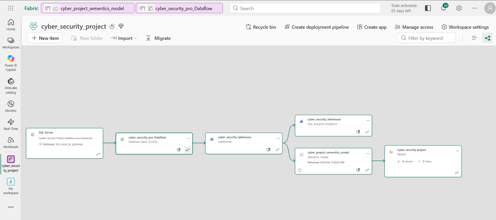
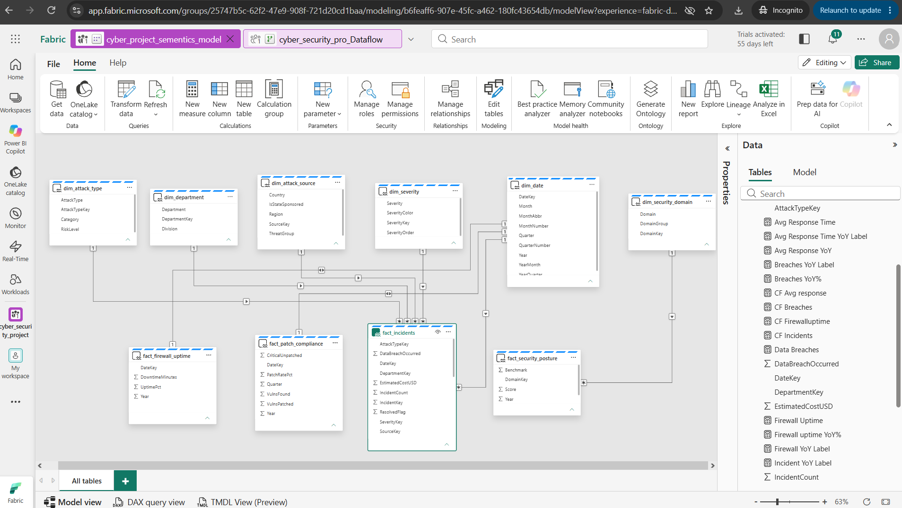
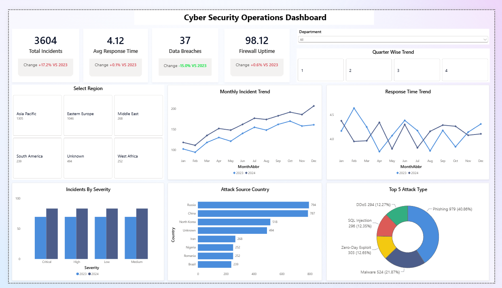

# 🛡️ Enterprise Cyber Security Analytics | Microsoft Fabric & Power BI

Cyber Security Analytics | Microsoft Fabric &amp; Power BI  An end-to-end hybrid analytics solution ingesting on-premises relational database records into Microsoft Fabric Lakehouse via Dataflow Gen2, modeled in Direct Lake mode, and visualized in Power BI.   

## 🏗️ Architecture Overview

[MS SQL Server (On-Premises)]
             │
             ▼
[On-Premises Data Gateway (TCP/IP 1433)]
             │
             ▼
[Fabric Dataflow Gen2 (ETL Pipeline)]
             │
             ▼
[OneLake / Fabric Lakehouse (Delta Parquet Tables)]
             │
             ▼
[Direct Lake Semantic Model (Star Schema)]
             │
             ▼
[Power BI Executive Dashboard]

## 📊 Semantic Model & Data Modeling

Dimensions (6): dim_date, dim_attack_source, dim_attack_type, dim_department, dim_security_domain, dim_severity

Facts (4): fact_incidents, fact_firewall_uptime, fact_patch_compliance, fact_security_posture

Storage Mode: Direct Lake / Lakehouse Endpoint

## 📈 Key Dashboard Metrics

Total Incident Volume & YoY Trend: Real-time tracking of security incidents versus prior year baselines.

Mean Time to Response (MTTR): Average response time tracking across quarters and departments.

Threat Actor Attribution: Geographic origin and threat group tracking (APT28, APT41, Lazarus, etc.).

Attack Vector Distribution: Share of attacks across Phishing, Malware, Zero-Day Exploits, and DDoS.

🛠️ Tech Stack & Skills
Database: Microsoft SQL Server Express

Ingestion: On-Premises Data Gateway, Microsoft Fabric Dataflow Gen2

Storage & Lakehouse: Microsoft OneLake, Delta Lake

Modeling & DAX: Microsoft Fabric Semantic Models, Direct Lake, Custom Measures

Visualization: Power BI (New Card Visual, Reference Labels, Dynamic Slicers)
